# Phân tích review Steam: phân loại cảm xúc, phân tích theo khía cạnh và gợi ý game

## 1. Giới thiệu

Review trên Steam gồm một đoạn chữ tự do và một nút Recommend / Not Recommended. Nút này chỉ cho biết người viết có khuyên chơi game hay không, không cho biết họ hài lòng hay không hài lòng ở điểm nào. Một review có thể khen đồ hoạ nhưng chê lỗi, và cũng có review đùa cợt hoặc mỉa mai.

Đề tài đặt ra các mục tiêu sau:

1. **Phân loại cảm xúc** của review từ nội dung chữ.
2. **Lọc review đáng ngờ**, là các review có nội dung mâu thuẫn với nút bấm như mỉa mai, troll, bấm nhầm.
3. **Chấm mức hữu ích** của review.
4. **Phân tích theo khía cạnh:** xác định câu nói về đồ hoạ, âm thanh, gameplay... và khen hay chê từng khía cạnh đó.
5. **Gợi ý game:** gộp game theo thể loại và nhà phát hành, từ đó gợi ý game cùng nhóm cho người dùng.

Mô hình cơ sở được xây dựng bằng TensorFlow/Keras. Phần phân tích khía cạnh sử dụng kết hợp từ khoá và mô hình transformer DistilBERT. Hình 1 tóm tắt quy trình.

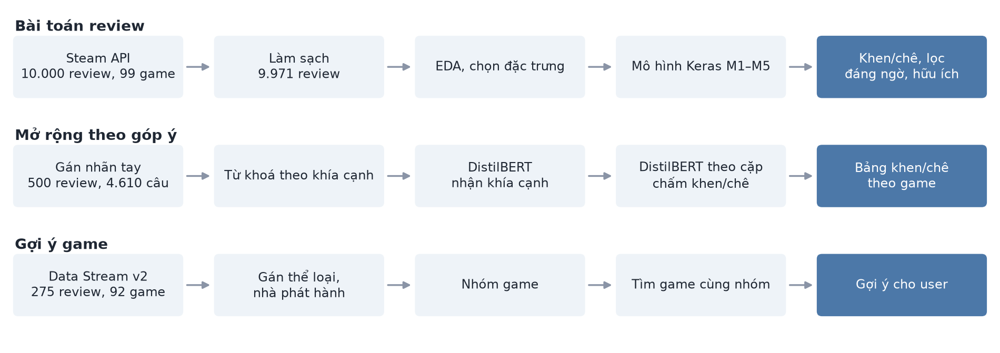

## 2. Dữ liệu

### 2.1. Nguồn và cách lấy dữ liệu

Đề tài dùng hai bộ dữ liệu.

**Bộ `steam_reviews`** do nhóm thu thập qua API review của Steam trong khoảng 21–28/09/2026, gồm 10.000 review của 99 game. Với mỗi game, nhóm lấy 50 review khen và 50 review chê mới nhất, viết trong khoảng từ 12/2025 đến 09/2026. Mỗi dòng gồm mã game, tên game, mã review, nội dung, nhãn cảm xúc, giờ chơi, số vote hữu ích và thời điểm viết. Toàn bộ review được công cụ nhận diện ngôn ngữ xác định là tiếng Anh.

Cách lấy này có hai hệ quả cần lưu ý:

- Tỉ lệ khen/chê được cân bằng theo chủ đích, nên **không phản ánh tỉ lệ thật của từng game**.
- Review chê hiếm hơn nên phải lùi xa hơn về quá khứ để đủ 50 review. Vì vậy, thời điểm viết và số vote hữu ích tương quan mạnh với nhãn do cách lấy mẫu, không phải do nội dung. Hai cột này không được dùng để dự đoán cảm xúc.

**Bộ `Data Stream v2`** gồm 299 review bằng tiếng Việt của 100 mục game, chia theo ba nhóm người chơi: nhiều game nhất, tầm trung, ít game nhất. Bộ này có thông tin số game sở hữu, số review đã viết và giờ chơi, được dùng cho phần gợi ý. Do có nhiều đặc điểm của dữ liệu mô phỏng, như văn bản đều đặn, số tròn và các bản lặp giống hệt, báo cáo xem đây là **dữ liệu minh hoạ** cho bài toán gợi ý, không xem là review thật.

### 2.2. Làm sạch

Với `steam_reviews`, các bước làm sạch gồm:

| Bước | Cách làm | Kết quả |
|---|---|---|
| Bỏ trùng | So khớp nội dung sau khi chuyển chữ thường và gộp khoảng trắng; giữ bản đầu; nhóm trùng nhưng khác nhãn thì bỏ cả nhóm | Loại 29 review (25 trùng, 4 khác nhãn) |
| Xoá định dạng | Xoá thẻ BBCode của Steam nhưng giữ nội dung trong thẻ; xoá URL | Sửa 82 review |
| Chuẩn hoá ký tự | Đổi chuỗi `♥♥` do Steam che từ tục thành `<censored>`; giữ emoji và tách thành token riêng | Không có review rỗng |
| Gắn cờ chất lượng | Bị cắt, lặp từ, quá ngắn, lẫn ngôn ngữ; chỉ gắn cờ, không xoá | 20 review có cờ |
| Sửa tên game | Chuẩn hoá tên lỗi | 13 tên |

Kết quả là **9.971 review**, gồm 5.000 khen và 4.971 chê, độ dài trung vị 20 từ, trung bình 54,9 từ.

Với `Data Stream v2`, các dòng lặp của 8 game được loại, còn **275 review của 92 game**. Mỗi người dùng được gán mã riêng vì Steam ID trong file gốc đã mất độ chính xác. Nhà phát hành được ghép từ bộ `Data Stream` trước đó (79/92 game), 13 game còn lại được điền tay. Thể loại được gán tay thành 15 nhóm. Kết quả có 69 nhà phát hành, trong đó 14 nhà phát hành có từ hai game trở lên.

### 2.3. Khám phá dữ liệu

Các kết quả chính:

- **Nội dung chữ là tín hiệu chính.** Đặc trưng phụ mạnh nhất chỉ đạt thông tin tương hỗ khoảng 0,044 trên mức tối đa 0,693. Từ vựng tách rõ hai lớp: *fun, best, love* so với *censored, boring, worst, crashes*.
- **Review càng dài càng nghiêng về chê** (ρ = −0,26), xu hướng cùng dấu ở 96/97 game.
- **Giờ chơi có quan hệ hình chữ ∩:** nhóm dưới 2 giờ chỉ có 14% review khen, nhóm 10–50 giờ có 57%.
- **Điểm ghi trong review** (dạng x/10) là tín hiệu mạnh nhưng chỉ xuất hiện ở 4,4% review.

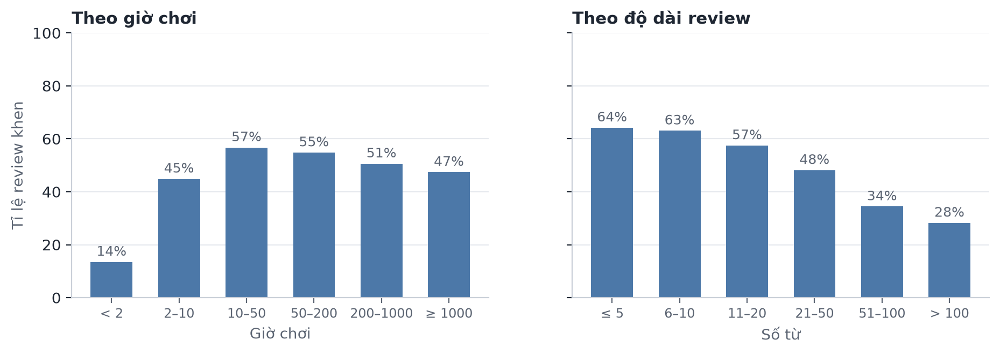

### 2.4. Dữ liệu gán nhãn tay

Nhãn Steam chỉ cho biết cảm xúc chung của cả review, nên để đánh giá sâu hơn và huấn luyện mô hình khía cạnh, đề tài bổ sung nhãn tay. Việc gán nhãn do mô hình ngôn ngữ Claude thực hiện theo quy tắc viết sẵn, không xem nhãn Steam, tên game hay dự đoán của mô hình. **Các nhãn này chưa được người kiểm tra độc lập**, nên điểm số ở các phần dùng nhãn này có nghĩa là mức độ mô hình đọc giống người gán nhãn.

| Bộ nhãn | Số lượng | Nguồn | Mục đích |
|---|---|---|---|
| Review | 500 | Ngẫu nhiên từ tập test | Phân tích lỗi của mô hình cảm xúc |
| Câu, Test 1 | 500 | Ngẫu nhiên từ tập test | Chấm mô hình khía cạnh |
| Câu, bổ sung | 110 | Từ tập test, chọn theo từ khoá | Tăng số mẫu chấm khen/chê |
| Câu, Test 2 | 500 | Ngẫu nhiên từ tập test, gán sau khi đã khoá danh sách từ khoá | Chấm công bằng giữa các phương pháp |
| Câu, dev | 438 | Ngẫu nhiên, ngoài tập test | Chọn ngưỡng, epoch và phương án |
| Câu, train | 2.913 | Ngoài tập test, gồm câu ngẫu nhiên, câu chọn theo từ khoá và câu trái cảm xúc | Huấn luyện |

Nhãn review gồm cảm xúc (khen, chê, vừa khen vừa chê, không rõ) và loại (bình thường, đùa, mỉa mai, lạc đề, quá ngắn). Trong 500 review có 217 chê, 187 khen, 71 không rõ, 25 vừa khen vừa chê; 76 review thuộc loại đùa/meme. Với các review có cảm xúc rõ ràng, nhãn tay khớp nhãn Steam ở 94,8% trường hợp.

Nhãn câu ghi từng cặp khía cạnh và cảm xúc. Có 8 khía cạnh: đồ hoạ, âm thanh, gameplay, cốt truyện, hiệu năng/lỗi, giá/trả phí, online/cộng đồng, nhà phát triển. Cảm xúc gồm khen, chê, trung tính và không rõ. Câu chung chung như "game hay" không gắn khía cạnh.

## 3. Mô hình cơ sở bằng Keras

### 3.1. Cách đánh giá

Mô hình được đánh giá theo hai kịch bản:

- **Kịch bản A, game đã biết:** chia ngẫu nhiên 70% train, 15% validation, 15% test, giữ tỉ lệ nhãn.
- **Kịch bản B, game mới:** 20% số game được tách làm test, review của các game này không xuất hiện khi train. Kịch bản này kiểm tra mô hình có học cách người chơi khen/chê nói chung hay chỉ nhớ từ riêng của từng game.

Chỉ số chính là ROC-AUC, kèm độ chính xác.

### 3.2. Bài 1: phân loại cảm xúc

Mô hình nhận chữ và 10 đặc trưng phụ: độ dài, khoảng giờ chơi, điểm x/10, có dấu hỏi, có từ bị che. Các mốc so sánh là Logistic Regression (LR) trên đặc trưng phụ và trên TF-IDF.

| Mô hình | Xử lý chữ | ROC-AUC A | ROC-AUC B |
|---|---|---|---|
| Chỉ đặc trưng phụ + LR | Không dùng chữ | 0,716 | 0,711 |
| TF-IDF + LR | Cụm từ và cụm ký tự | 0,903 | 0,906 |
| TF-IDF + phụ + LR | Như trên, thêm đặc trưng phụ | 0,908 | 0,909 |
| M1 | Embedding + Average Pooling | 0,836 | 0,883 |
| M2 | Embedding + BiLSTM | 0,884 | 0,893 |
| M3 | Embedding + CNN 1D | 0,871 | 0,883 |
| M4 | TF-IDF cụm 1–2 từ + Dense | 0,891 | 0,893 |
| M5 | Trung bình dự đoán M2 và M4 | 0,902 | 0,905 |

Kết quả cho thấy nội dung chữ đóng góp phần lớn thông tin. Các mạng tự học embedding (M1–M3) không vượt LR vì dữ liệu nhỏ và bắt đầu overfit sau 2–3 epoch. M5 đạt độ chính xác khoảng 0,82–0,83. Điểm ở kịch bản B không thấp hơn kịch bản A, nên mô hình áp dụng được cho game chưa gặp.

### 3.3. Bài 2: lọc review đáng ngờ

Do không có nhãn sẵn, đề tài dùng dự đoán chéo 5 phần bằng M4 (ROC-AUC 0,90) để mỗi review đều được chấm bởi mô hình chưa từng thấy nó. Review bị gắn cờ khi mô hình rất chắc về một hướng nhưng nhãn theo hướng ngược lại (p ≥ 0,9 mà bấm chê, hoặc p ≤ 0,1 mà bấm khen), hoặc khi dính cờ chất lượng. Kết quả có **290 review đáng ngờ (2,9%)**: 270 do mâu thuẫn và 20 do cờ chất lượng. Đọc mẫu cho thấy các nhóm chính là mỉa mai, review hỗn hợp và bấm nhầm.

### 3.4. Bài 3: chấm mức hữu ích

Mục tiêu là dự đoán review có ít nhất một vote hữu ích (32,5% review). Vì review cũ có nhiều thời gian nhận vote hơn, tuổi review được đưa vào làm biến kiểm soát.

| Mô hình | ROC-AUC |
|---|---|
| Chỉ tuổi review | 0,62 |
| Đặc trưng phụ + tuổi | 0,77 |
| TF-IDF + đặc trưng phụ + tuổi, LR | 0,79 |
| Keras M4 + đặc trưng phụ + tuổi | 0,76 |

Nhãn chê là yếu tố mạnh nhất, nên kết quả cần được hiểu với lưu ý về cách lấy mẫu ở mục 2.1.

## 4. Transformer cho phân loại cảm xúc

### 4.1. Phương pháp

Mục 3.2 cho thấy mạng tự học embedding bị giới hạn bởi dữ liệu nhỏ, nên hướng tiếp theo là dùng mô hình đã huấn luyện sẵn. Đề tài fine-tune **DistilBERT** (`distilbert-base-uncased`):

- Đầu vào tối đa 128 token, review dài hơn giữ phần đầu và phần cuối.
- Lấy trung bình vector các token, qua Dropout 0,2 và một lớp sigmoid.
- AdamW, tốc độ học 2e-5 với warmup và giảm dần theo cosine, batch 16, 3 epoch, chọn epoch tốt nhất trên validation.
- Lặp lại với 3 seed. Huấn luyện bằng Keras 3 và keras-hub trên GPU GTX 1650 (4 GB), mỗi lần chạy khoảng 10 phút. Do TensorFlow bản mới không hỗ trợ GPU trên Windows, phần này dùng Keras với nền PyTorch.

### 4.2. Kết quả

| Chỉ số | Kịch bản A | Kịch bản B |
|---|---|---|
| ROC-AUC trung bình 3 seed | 0,937 | 0,930 |
| Độ chính xác | khoảng 0,86 | khoảng 0,855 |
| Khoảng tin cậy 95% của mức tăng so với TF-IDF + LR | +0,026 đến +0,047 | +0,017 đến +0,037 |

DistilBERT vượt mọi mô hình trước ở cả hai kịch bản. Mức tăng lớn hơn dao động giữa các seed (khoảng 0,002) và khoảng tin cậy không chứa 0.

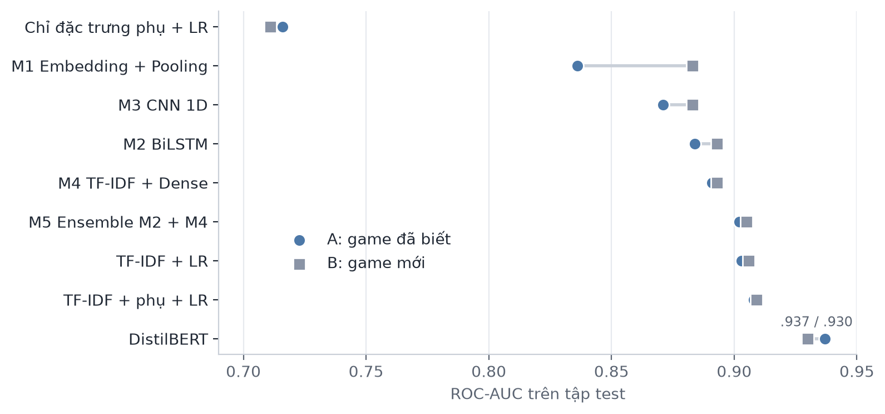

Để biết phần cải thiện nằm ở đâu, 500 review đọc tay được dùng để phân tích lỗi:

| Nhóm review | Số review | M4 | DistilBERT |
|---|---|---|---|
| Tất cả, ROC-AUC | 500 | 0,887 | 0,931 |
| Rõ ràng, ROC-AUC | 365 | 0,942 | 0,968 |
| Còn lại (đùa, hỗn hợp, không rõ...), ROC-AUC | 135 | 0,672 | 0,758 |

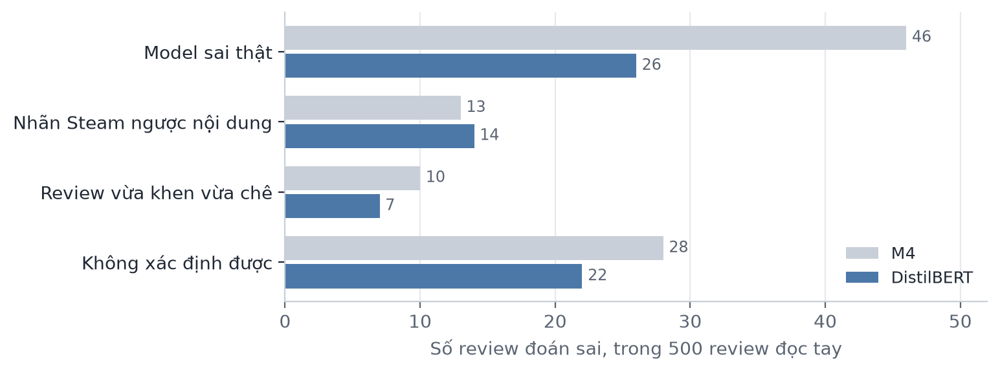

Số lần mô hình sai thật giảm từ 46 xuống 26, trong khi số lỗi do nhãn Steam ngược với nội dung gần như không đổi (13 và 14). Điều này cho thấy mô hình mạnh hơn cải thiện khả năng đọc hiểu, còn phần lỗi do nhãn thì không thể sửa bằng mô hình.

## 5. Phân tích theo khía cạnh

### 5.1. Phương pháp

Bài toán được chia làm hai bước: nhận các khía cạnh được nhắc tới trong câu, rồi chấm khen/chê cho từng khía cạnh.

**Nhận khía cạnh** là bài toán đa nhãn, với ngưỡng riêng cho mỗi khía cạnh chọn trên tập dev. Các phương pháp được so sánh:

- **Từ khoá:** danh sách biểu thức chính quy cho từng khía cạnh.
- **TF-IDF + LR:** mốc so sánh.
- **DistilBERT:** fine-tune với đầu ra 8 nhãn, 6 epoch.
- **Hợp:** từ khoá hoặc DistilBERT nói có thì tính là có.
- **Từ khoá trong đầu vào:** các khía cạnh do từ khoá tìm được đưa vào trước câu, `[CLS] graphics price [SEP] câu [SEP]`, để mô hình tự quyết định có tin từ khoá hay không.

**Chấm khen/chê theo cặp:** mô hình nhận `[CLS] khía cạnh [SEP] câu [SEP]` và dự đoán khen/chê cho riêng khía cạnh đó, nhờ vậy một câu có thể có các cảm xúc khác nhau cho từng khía cạnh. Trọng số khởi tạo lấy từ mô hình cảm xúc đã học trên nhãn Steam. Để tăng dữ liệu cho trường hợp khó, tập train có thêm 188 câu chọn theo từ nối đối lập và có nhiều khía cạnh.

**Đánh giá:** phương án được chọn trên tập dev, tập test chỉ dùng để báo cáo. Danh sách từ khoá được viết sau khi đã đọc Test 1 nên có lợi thế trên tập này, vì vậy Test 2 được gán nhãn sau khi đã khoá danh sách từ khoá và là tập chấm chính.

### 5.2. Nhận khía cạnh

| Phương pháp | Số câu train | Dev | Test 2 | Test 1 |
|---|---|---|---|---|
| Từ khoá | 0 | 0,546 | 0,557 | 0,640 |
| TF-IDF + LR | 2.913 | 0,605 | 0,602 | 0,602 |
| DistilBERT | 1.265 | 0,655 | 0,606 | 0,635 |
| Từ khoá trong đầu vào | 1.265 | 0,692 | 0,640 | 0,696 |
| Từ khoá trong đầu vào | 1.995 | 0,708 | 0,665 | 0,714 |
| **Từ khoá trong đầu vào (được chọn theo dev)** | 2.725 | 0,733 | 0,682 | 0,722 |
| Từ khoá trong đầu vào | 2.913 | 0,731 | 0,692 | 0,731 |
| DistilBERT | 2.913 | 0,729 | 0,679 | 0,715 |
| Hợp từ khoá với DistilBERT | 2.913 | 0,722 | 0,687 | 0,723 |

*Điểm là micro F1, trung bình các seed. Dev dùng để chọn phương án, Test 2 là tập chấm chính.*

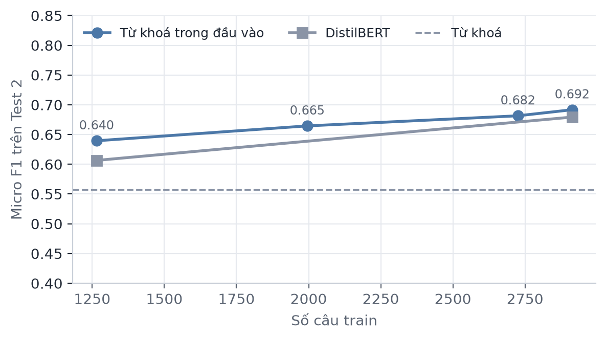

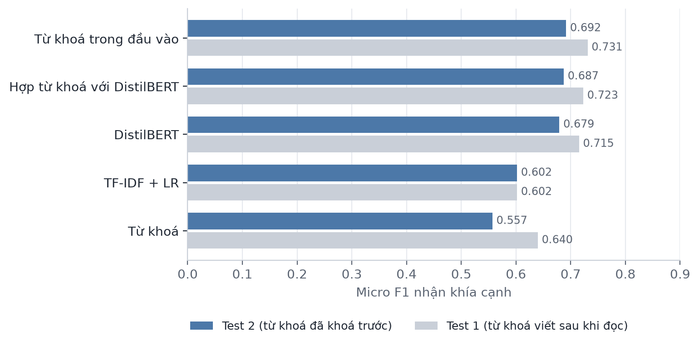

Từ kết quả có thể rút ra:

- **Transformer vượt từ khoá và TF-IDF.** So với từ khoá, phương án được chọn hơn 0,125 (khoảng tin cậy 95%: 0,085 đến 0,169). So với TF-IDF + LR, mức chênh là 0,080 (0,040 đến 0,120).
- **Từ khoá trong đầu vào có lợi khi ít nhãn.** Ở 1.265 câu, phương án này hơn DistilBERT thường 0,033. Ở gần 3.000 câu, chênh lệch thu hẹp: so với DistilBERT 2.913 câu, phương án được chọn chỉ hơn 0,003 và khoảng tin cậy chứa 0 (−0,017 đến 0,024).
- **Thêm nhãn cải thiện kết quả, nhưng chậm dần:** 0,025 rồi 0,017 cho mỗi 730 câu thêm vào.
- **Từ khoá riêng có recall thấp:** precision 0,735, recall 0,448 trên Test 2. Điểm trên Test 1 cao hơn (0,640) vì danh sách từ khoá được viết sau khi đọc tập này.

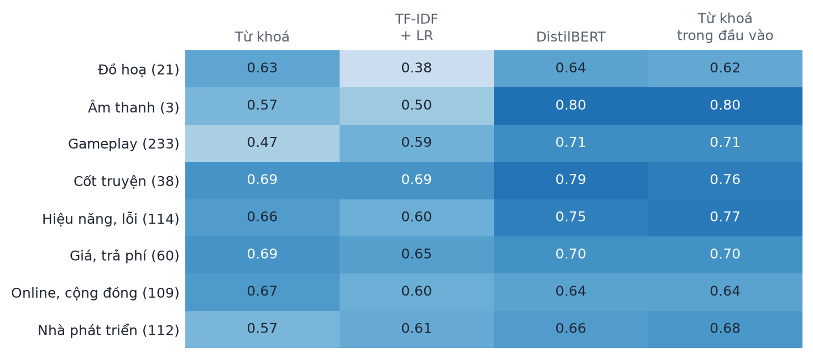

Gameplay là khía cạnh được cải thiện nhiều nhất so với từ khoá (0,47 lên 0,71), vì người chơi nói về gameplay bằng rất nhiều cách khó liệt kê. Online/cộng đồng và nhà phát triển có điểm thấp hơn (0,64 và 0,68). Âm thanh (3 câu) và đồ hoạ (21 câu) có quá ít mẫu nên điểm của hai khía cạnh này chưa đủ tin cậy.

### 5.3. Khen/chê theo khía cạnh

Với các cặp khía cạnh đã biết trước trên hai tập test (765 cặp, nhãn khen hoặc chê), mô hình theo cặp đạt độ chính xác 0,898. Mức cơ sở khi luôn đoán chê là 0,689.

| So với | Độ chính xác của mô hình đó | Mức chênh của mô hình theo cặp | Khoảng tin cậy 95% |
|---|---|---|---|
| M4 đọc cả câu | 0,742 | +0,156 | +0,125 đến +0,188 |
| DistilBERT đọc cả câu | 0,835 | +0,063 | +0,042 đến +0,085 |

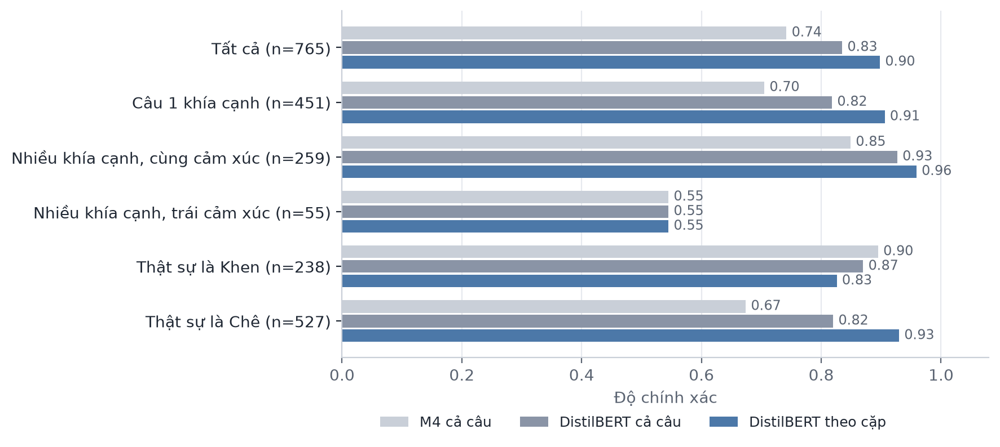

Kết quả theo nhóm cho thấy hai điểm:

- **Câu có nhiều khía cạnh trái cảm xúc chưa được cải thiện.** Cả ba mô hình đều đạt khoảng 0,55 trên 55 cặp, ROC-AUC của mô hình theo cặp là 0,58. Việc thêm 188 câu thuộc dạng này vào tập train không thay đổi kết quả (0,552 so với 0,545). Đây là trường hợp mô hình theo cặp được kỳ vọng giải quyết, nên có thể nói mục tiêu này chưa đạt. Số mẫu ít khiến khoảng tin cậy còn rộng: so với M4, mức chênh là 0,000 (−0,145 đến +0,139).
- **Mô hình nghiêng về chê.** So với M4, độ chính xác nhóm chê tăng từ 0,674 lên 0,930, còn nhóm khen giảm từ 0,895 xuống 0,826.

### 5.4. Cả đường ống

Ở bước này, một dự đoán chỉ đúng khi đúng cả khía cạnh lẫn cảm xúc.

| Đường ống | Precision (Test 2) | Recall (Test 2) | F1 (Test 2) | F1 (Test 1) |
|---|---|---|---|---|
| Từ khoá + M4 (bản đầu tiên) | 0,572 | 0,372 | 0,451 | 0,494 |
| Từ khoá + DistilBERT cả câu | 0,611 | 0,397 | 0,481 | 0,549 |
| Từ khoá + theo cặp | 0,638 | 0,414 | 0,502 | 0,579 |
| **Từ khoá trong đầu vào + theo cặp** | 0,607 | 0,638 | **0,622** | 0,640 |

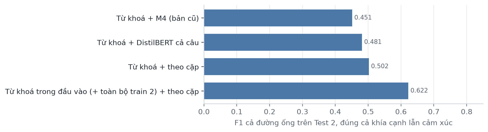

F1 tăng từ 0,451 lên 0,622, chủ yếu nhờ recall, trong khi precision gần như giữ nguyên. Nói cách khác, đường ống mới tìm được nhiều nhận xét hơn mà không sai thêm tương ứng.

### 5.5. Kết quả theo game

Đường ống được áp dụng cho toàn bộ 33.025 câu của 99 game, thu được 24.223 cặp khía cạnh và cảm xúc.

| Khía cạnh | Số cặp | Tỉ lệ chê |
|---|---:|---:|
| Gameplay | 10.297 | 62,6% |
| Nhà phát triển | 3.320 | 85,2% |
| Online, cộng đồng | 3.235 | 75,1% |
| Hiệu năng, lỗi | 2.844 | 90,3% |
| Giá, trả phí | 2.409 | 77,7% |
| Cốt truyện | 1.029 | 49,0% |
| Đồ hoạ | 819 | 31,0% |
| Âm thanh | 270 | 43,7% |

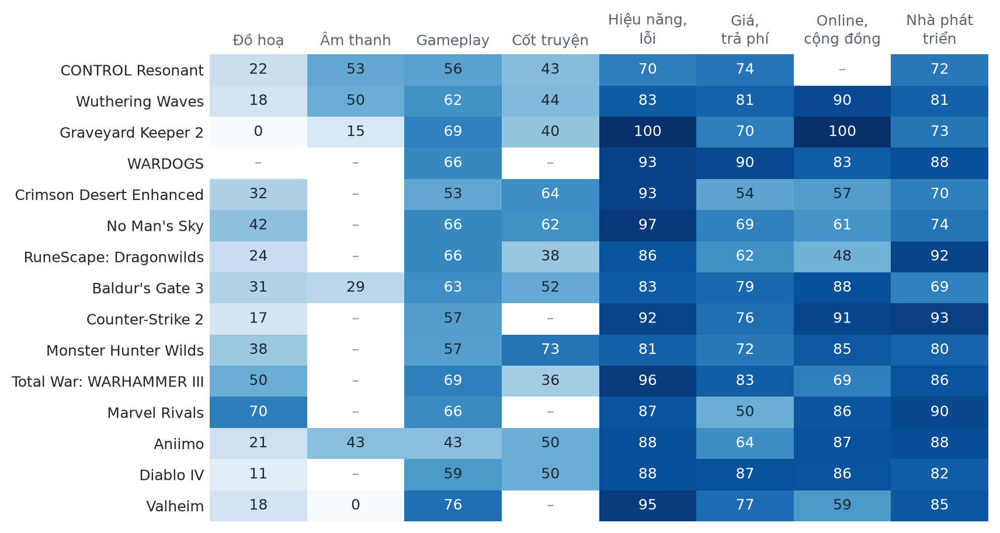

Người chơi chê nhiều nhất về hiệu năng/lỗi và nhà phát triển, ít nhất về đồ hoạ. Hình 10 cho thấy sự khác nhau giữa các game, nhưng nhiều ô chỉ dựa trên vài chục câu hoặc ít hơn. Các tỉ lệ này chỉ nên dùng để so sánh tương đối giữa các khía cạnh và các game, vì dữ liệu lấy 50 review khen và 50 review chê mỗi game, review chê dài hơn nên có nhiều câu hơn, và mô hình có xu hướng nghiêng về chê.

## 6. Gợi ý game

Mỗi người dùng trong dữ liệu chỉ có một review nên không thể dùng lọc cộng tác. Đề tài dùng cách gợi ý theo nhóm:

1. Gộp game thành đồ thị theo thể loại và nhà phát hành.
2. Với một người dùng đã khen một game, tìm các game cùng nhóm và tính điểm: `điểm = 2 × cùng thể loại + 1 × cùng nhà phát hành`. Điểm hoà thì xếp theo tỉ lệ đánh giá tích cực của game.
3. Nếu người dùng chê game đó, gợi ý từ các thể loại khác.

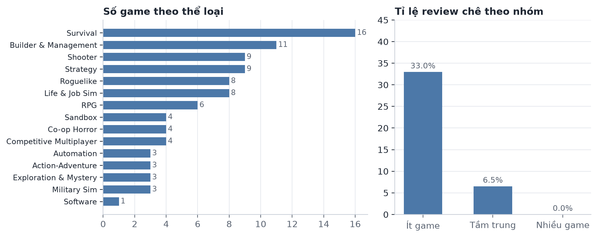

Trong bộ dữ liệu minh hoạ, nhóm ít game có 33% review chê, nhóm tầm trung 6,5% và nhóm nhiều game 0%. Các review chê thường nhắc đến lỗi kỹ thuật, độ khó và hack. Phần gợi ý chưa có đánh giá định lượng vì không có dữ liệu về hành vi thực tế của người dùng.

## 7. Ứng dụng minh hoạ

Các mô hình Keras được đóng gói thành ứng dụng web chạy trên máy (FastAPI và HTML/JavaScript, không cần mạng), gồm 4 trang:

| Trang | Chức năng |
|---|---|
| Phân tích review | Nhận một review tiếng Anh, trả về khen/chê, khả năng được vote hữu ích, cảnh báo khi nội dung ngược với nút bấm |
| Kiểm duyệt hàng loạt | Chọn game hoặc tải CSV; xem tỉ lệ khen/chê, tỉ lệ chê theo giờ chơi, từ hay gặp, lọc review đáng ngờ |
| Tổng quan dữ liệu | Số liệu tập train, so sánh mô hình |
| Gợi ý game | Đồ thị nhóm game và gợi ý theo người dùng hoặc game |

Ứng dụng hiện dùng mô hình M4. Mô hình transformer đã được lưu trọng số nhưng chưa tích hợp vào ứng dụng.

## 8. Hạn chế

- **Nhãn tay chưa được người kiểm tra độc lập.** Toàn bộ nhãn do mô hình ngôn ngữ Claude gán. Danh sách từ khoá cũng do cùng nguồn viết, nên các điểm ở mục 4 (phần 500 review) và mục 5 có thể cao hơn thực tế. Bộ file giấu nhãn đã được chuẩn bị để kiểm tra (`data/labels/KIEM_TRA_*.csv`) nhưng chưa được sử dụng.
- **Dữ liệu được lấy cân bằng theo game.** Tỉ lệ khen/chê không phản ánh thực tế. Số vote hữu ích và thời điểm viết bị ảnh hưởng bởi cách lấy mẫu, nên Bài 3 cần được hiểu với lưu ý này.
- **Một số nhóm có ít mẫu:** âm thanh, đồ hoạ và câu trái cảm xúc. Kết quả trên các nhóm này chưa đủ tin cậy.
- **Mô hình chỉ xử lý tiếng Anh** và chưa bắt được mỉa mai nhẹ.
- **Phần gợi ý dùng dữ liệu minh hoạ** và chưa có đánh giá định lượng.
- **Môi trường huấn luyện:** phần transformer dùng Keras 3 với nền PyTorch thay vì TensorFlow, do giới hạn hỗ trợ GPU trên Windows.

## 9. Kết luận

Đề tài đã xây dựng các mô hình phân loại cảm xúc, lọc review đáng ngờ, chấm mức hữu ích, phân tích theo khía cạnh và gợi ý game trên dữ liệu review Steam.

Kết quả chính:

| Bài toán | Mô hình cơ sở | Mô hình tốt nhất | Kết quả |
|---|---|---|---|
| Khen/chê cả review, kịch bản A / B (ROC-AUC) | TF-IDF + LR: 0,903 / 0,906 | DistilBERT | 0,937 / 0,930 |
| Nhận khía cạnh, Test 2 (micro F1) | Từ khoá: 0,557 | Từ khoá trong đầu vào DistilBERT | 0,682 |
| Khen/chê theo khía cạnh (độ chính xác) | M4 cả câu: 0,742 | DistilBERT theo cặp | 0,898 |
| Cả đường ống, Test 2 (F1) | Từ khoá + M4: 0,451 | Từ khoá trong đầu vào + theo cặp | 0,622 |

Việc dùng transformer đem lại cải thiện rõ rệt ở cả bốn dòng trên. Ở ba dòng đầu, khoảng tin cậy 95% của mức chênh so với mô hình cơ sở không chứa 0; dòng cả đường ống chưa tính khoảng tin cậy. Từ khoá có ích nhất khi đưa vào đầu vào của mô hình và khi ít dữ liệu; khi đã có gần 3.000 câu train, lợi thế này không còn rõ. Mô hình theo cặp tăng độ chính xác chung nhưng chưa giải quyết được câu có các khía cạnh trái cảm xúc.

Các hướng phát triển:

1. Cho người kiểm tra một mẫu nhãn để đo mức đồng thuận, từ đó biết điểm số hiện tại đáng tin đến đâu.
2. Gán thêm nhãn có chọn lọc cho âm thanh, đồ hoạ và câu trái cảm xúc, thay vì gán đều.
3. Thử mô hình có cấu trúc riêng cho câu trái cảm xúc, ví dụ tách câu thành mệnh đề trước khi chấm.
4. Đưa mô hình transformer vào ứng dụng.
5. Thu thập dữ liệu theo tỉ lệ tự nhiên và có mã người dùng thật để đánh giá phần gợi ý.

## Phụ lục: vị trí kết quả

| Nội dung | File |
|---|---|
| Làm sạch và EDA `steam_reviews` | `preprocessing.ipynb` |
| Làm sạch và EDA `Data Stream v2` | `preprocessing_v2.ipynb` |
| Mô hình Keras, Bài 1–3 | `model.ipynb` |
| DistilBERT khen/chê, khía cạnh bước đầu | `aspect_model.ipynb` |
| Cách kết hợp từ khoá, đường cong học | `aspect_model_run2.ipynb` |
| Thêm nhãn, Test 2, kết quả cuối | `aspect_model_run3.ipynb` |
| Nhãn và quy tắc gán nhãn | `data/labels/` |
| Hình trong báo cáo | `report/make_figures.py`, `report/figures/` |
| Ứng dụng | `app/` |
